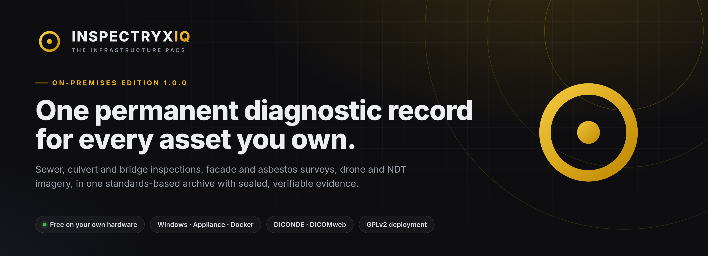
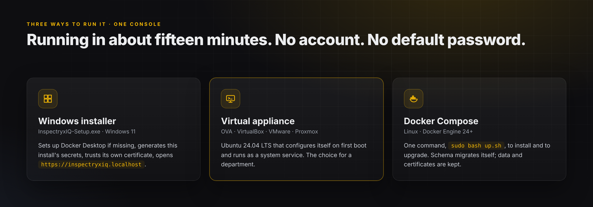
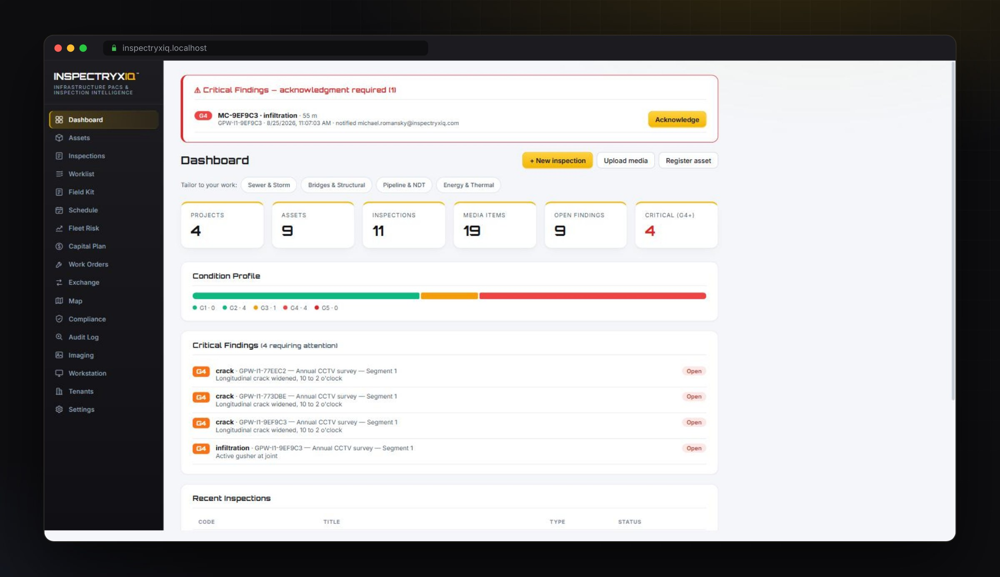
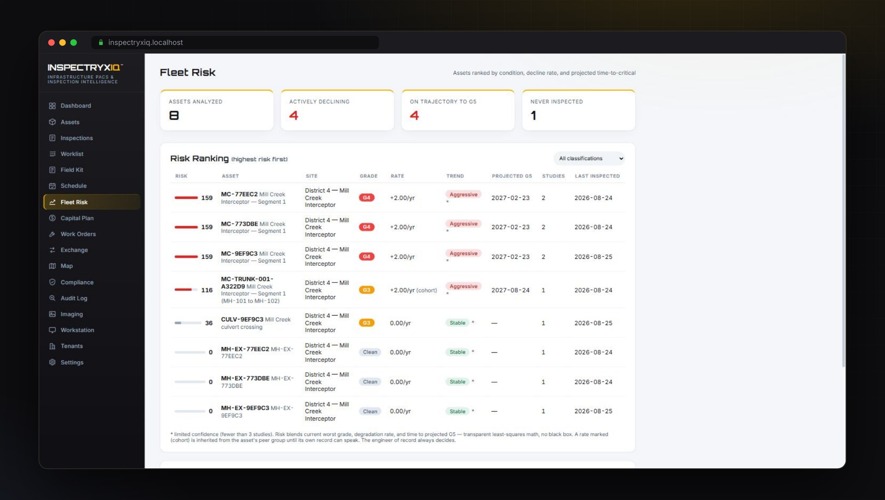
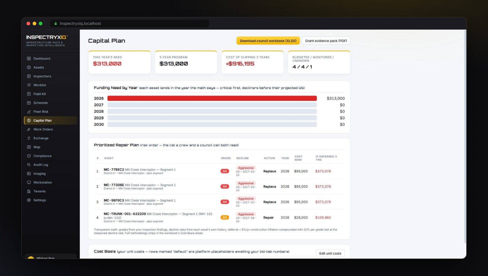
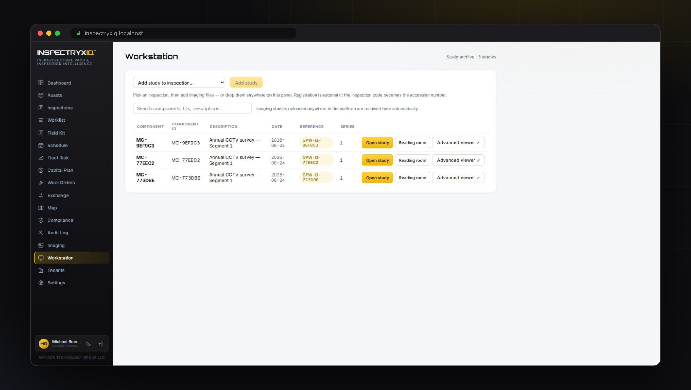
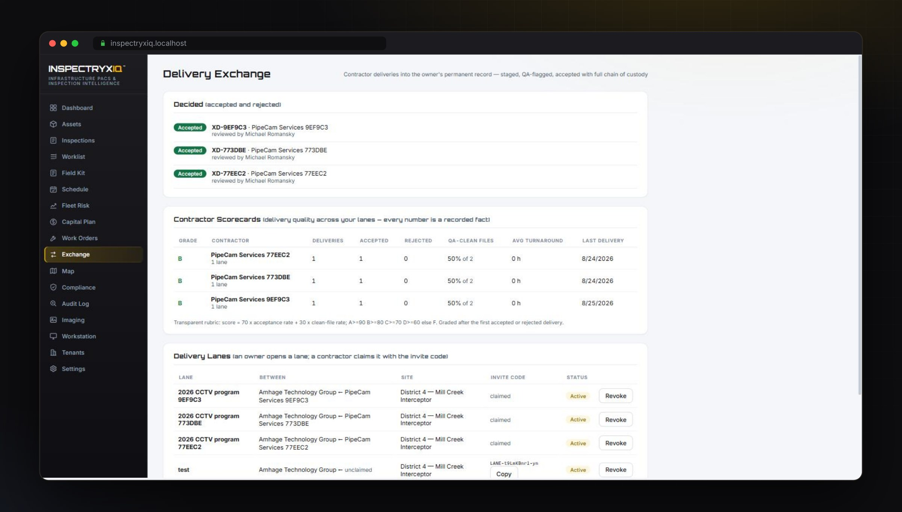
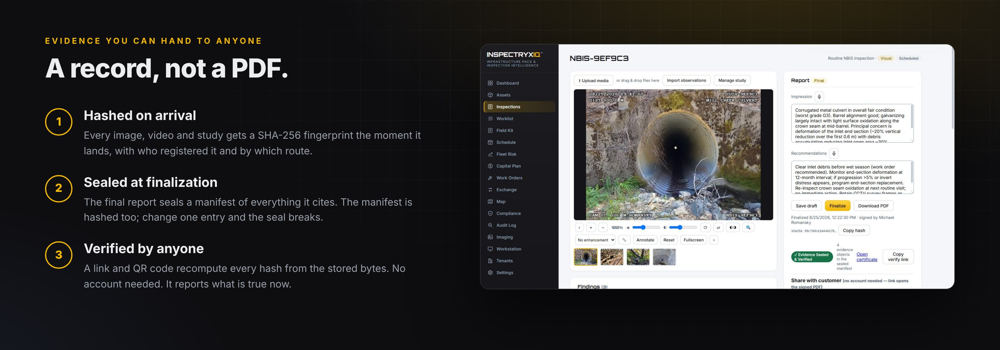
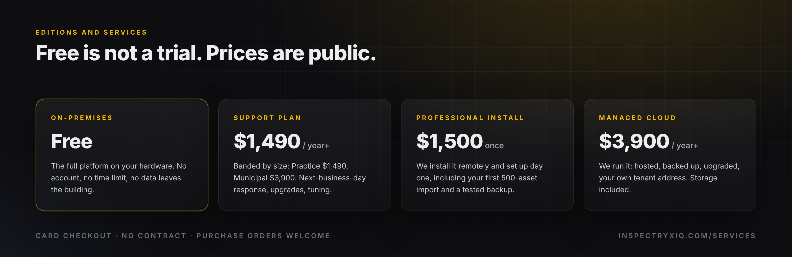
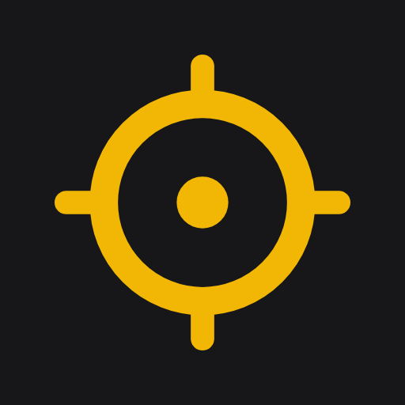

<p align="center">
  <a href="https://inspectryxiq.com"></a>
</p>

<p align="center">
  <a href="https://github.com/Amhage-Technology-Group/inspectryxiq-releases/releases/latest"></a>
  <a href="https://github.com/Amhage-Technology-Group/inspectryxiq-releases/releases"></a>
  <a href="COPYING"></a>
  
</p>

<p align="center">
  <a href="https://github.com/Amhage-Technology-Group/inspectryxiq-releases/releases/latest/download/InspectryxIQ-Setup.exe"><b>Download for Windows</b></a>
  &nbsp;·&nbsp;
  <a href="https://github.com/Amhage-Technology-Group/inspectryxiq-releases/releases/latest/download/InspectryxIQ-Appliance-1.0.0.ova"><b>Virtual appliance</b></a>
  &nbsp;·&nbsp;
  <a href="https://github.com/Amhage-Technology-Group/inspectryxiq-releases/releases/latest/download/inspectryxiq-deploy-v1.0.0.zip"><b>Docker Compose</b></a>
  &nbsp;·&nbsp;
  <a href="#documentation">Manuals</a>
  &nbsp;·&nbsp;
  <a href="https://inspectryxiq.com">inspectryxiq.com</a>
</p>

<br>

Healthcare solved enterprise imaging thirty years ago. Every patient gets one archive, kept for life, readable on any workstation, signed and auditable. **InspectryxIQ applies that discipline to the things a community owns.** The asset is the patient. An inspection is a study. The archive is permanent.

CCTV sewer and culvert video, bridge photography, facade and asbestos surveys, drone sets, NDT radiography and ultrasound, thermal and LiDAR all land in one standards-based DICONDE archive. Findings are graded G1 to G5. Final reports seal an evidence manifest anyone can verify. Fleet Risk and the Capital Plan are computed from the record itself, not from a spreadsheet beside it.

Built for **public agencies, water and wastewater utilities, DOTs, engineering and inspection firms, and NDT labs** by Amhage Technology Group LLC, Rochester, New York.

<br>

<p align="center"></p>

## Get started

<table>
<tr>
<td width="33%" valign="top">

**Windows 11**

Download [`InspectryxIQ-Setup.exe`](https://github.com/Amhage-Technology-Group/inspectryxiq-releases/releases/latest/download/InspectryxIQ-Setup.exe) and run it. The browser opens `https://inspectryxiq.localhost/` on a setup page where you create your organization and administrator.

</td>
<td width="33%" valign="top">

**Hypervisor**

Import [`InspectryxIQ-Appliance-1.0.0.ova`](https://github.com/Amhage-Technology-Group/inspectryxiq-releases/releases/latest/download/InspectryxIQ-Appliance-1.0.0.ova), set the adapter to Bridged, power on. The VM screen shows the console address after first boot.

</td>
<td width="33%" valign="top">

**Linux**

```bash
curl -fLO https://github.com/Amhage-Technology-Group/inspectryxiq-releases/releases/latest/download/inspectryxiq-deploy-v1.0.0.zip
unzip inspectryxiq-deploy-v1.0.0.zip
cd inspectryxiq-deploy && sudo bash up.sh
```

</td>
</tr>
</table>

## The platform

<p align="center"></p>

<table>
<tr>
<td width="50%"><br><sub><b>Fleet Risk.</b> Every asset ranked by measured condition, consequence of failure and the age of its last record.</sub></td>
<td width="50%"><br><sub><b>Capital Plan.</b> Dollars computed from the record: what to do, in what order, inside the budget you set.</sub></td>
</tr>
<tr>
<td width="50%"><br><sub><b>Workstation.</b> The diagnostic viewer for images, video and DICONDE studies: measure, annotate, grade.</sub></td>
<td width="50%"><br><sub><b>Exchange.</b> Contractors deliver into lanes you open; every delivery lands in a QA queue for you to accept.</sub></td>
</tr>
</table>

| Capture | Read and decide | Prove |
|---|---|---|
| Assets with permanent history | Worklist and diagnostic Workstation | Reports: draft, final, amended, never deleted |
| Inspections with CCTV, photo, drone, NDT, thermal, LiDAR | Findings graded G1 to G5, PACP-style coding | SHA-256 evidence manifests sealed at finalization |
| Field Kit for phones and tablets | Fleet Risk and Capital Plan | Public verification links and QR codes |
| Watched folder and DICOM receive | Work Orders and Schedule | Append-only Audit Log and Compliance |
| Delivery Exchange with QA | Map | Roles, client portals, second factor |

## Evidence you can hand to anyone

<p align="center"></p>

## Editions

<p align="center"></p>

| Edition | Price | What you get |
|---|---|---|
| **On-Premises Edition** | Free | The full platform on your own hardware. No account, no time limit, no data leaves the building. |
| **Support Plan** | from $1,490 / year | Practice (3 users) $1,490/yr or $149/mo · Municipal (25 users) $3,900/yr or $390/mo · Enterprise quoted. Business hours, next-business-day response, upgrade guidance, tuning. |
| **Professional Install** | $1,500 once | Remote installation and first-day setup: users, first import of up to 500 assets (our template), equipment, certificate rollout, tested backup. |
| **Managed Cloud** | from $3,900 / year | Hosted, backed up and upgraded for you, with your own tenant address. [Tiers](https://inspectryxiq.com/#pricing) |

Card checkout, no contract, purchase orders welcome: [inspectryxiq.com/services](https://inspectryxiq.com/services/) · [inspectryxiq.com/upgrade](https://inspectryxiq.com/upgrade/)

## System requirements

| | Minimum | Recommended |
|---|---|---|
| Windows | Windows 11 64-bit, 2 cores, 8 GB RAM, 60 GB free disk | 16 GB RAM, SSD |
| Linux | 64-bit, Docker Engine 24+ with Compose v2, 2 cores, 8 GB RAM, 60 GB disk | 16 GB RAM, SSD |
| Appliance | VirtualBox 7, VMware or Proxmox; 2 vCPU, 8 GB RAM, 60 GB disk | Bridged network, fixed address |

Measured on the 1.0.0 appliance: the five images total 4.1 GB, a fresh install uses 6.7 GB of disk including the OS, and the stack idles under 1 GB of memory. The rest of the 60 GB is room for your archive. Internet is needed for the first start and for upgrades only.

## Documentation

| Manual | For |
|---|---|
| [Quick Start Guide](https://github.com/Amhage-Technology-Group/inspectryxiq-releases/releases/latest/download/InspectryxIQ-Quick-Start-Guide-1.0.0.pdf) | Download to a sealed, verifiable report in about fifteen minutes |
| [Installation Guide](https://github.com/Amhage-Technology-Group/inspectryxiq-releases/releases/latest/download/InspectryxIQ-Installation-Guide-1.0.0.pdf) | Every platform; networking, certificates, equipment, upgrades, backup, troubleshooting |
| [Administrator Guide](https://github.com/Amhage-Technology-Group/inspectryxiq-releases/releases/latest/download/InspectryxIQ-Administrator-Guide-1.0.0.pdf) | The console, users and roles, data, reports and evidence, security practices |

## Security model

Only TCP 80 and 443 are published; the database, imaging engine and application are reachable only inside the stack. HTTPS is on from the first start through a per-install certificate authority. Every secret is generated on your machine at first start and lives in one file, `.env`. There is no default account. Writes are role-gated and a second factor can be required. Every media item is hashed on arrival and final reports seal a hashed manifest. DICOM receive stays closed until three deliberate steps open it. After the first start the platform needs no internet.

## Verifying downloads

Every release ships `SHA256SUMS.txt`.

```powershell
certutil -hashfile InspectryxIQ-Setup.exe SHA256      # Windows
```
```bash
sha256sum -c SHA256SUMS.txt                            # Linux, macOS
```

The Windows binaries are not yet code-signed; the checksum is the verification.

## Support

| | |
|---|---|
| Defects and installation problems | [Open an issue](https://github.com/Amhage-Technology-Group/inspectryxiq-releases/issues) |
| Support Plan, Professional Install | [inspectryxiq.com/services](https://inspectryxiq.com/services/) |
| Managed Cloud | [inspectryxiq.com/upgrade](https://inspectryxiq.com/upgrade/) |
| Security reports and everything else | support@inspectryxiq.com |

## Licensing and trademarks

The deployment files in each release (installer, Compose definitions, proxy and imaging-engine configuration, scripts, appliance build files) are licensed under the GNU General Public License v2 ([COPYING](COPYING)). The application images are distributed free of charge for use with them; third-party components (Orthanc, PostgreSQL, Caddy, nginx and others) remain under their own licenses. InspectryxIQ and the reticle mark are trademarks of Amhage Technology Group LLC ([TRADEMARKS.md](TRADEMARKS.md)). Terms: [TERMS.md](TERMS.md).

<br>

<p align="center">
  <br>
  <b>Amhage Technology Group LLC</b><br>
  <sub>Rochester, New York · Built on two decades of medical imaging PACS experience<br>
  InspectryxIQ · AeryxIQ · NeuryxIQ</sub>
</p>
